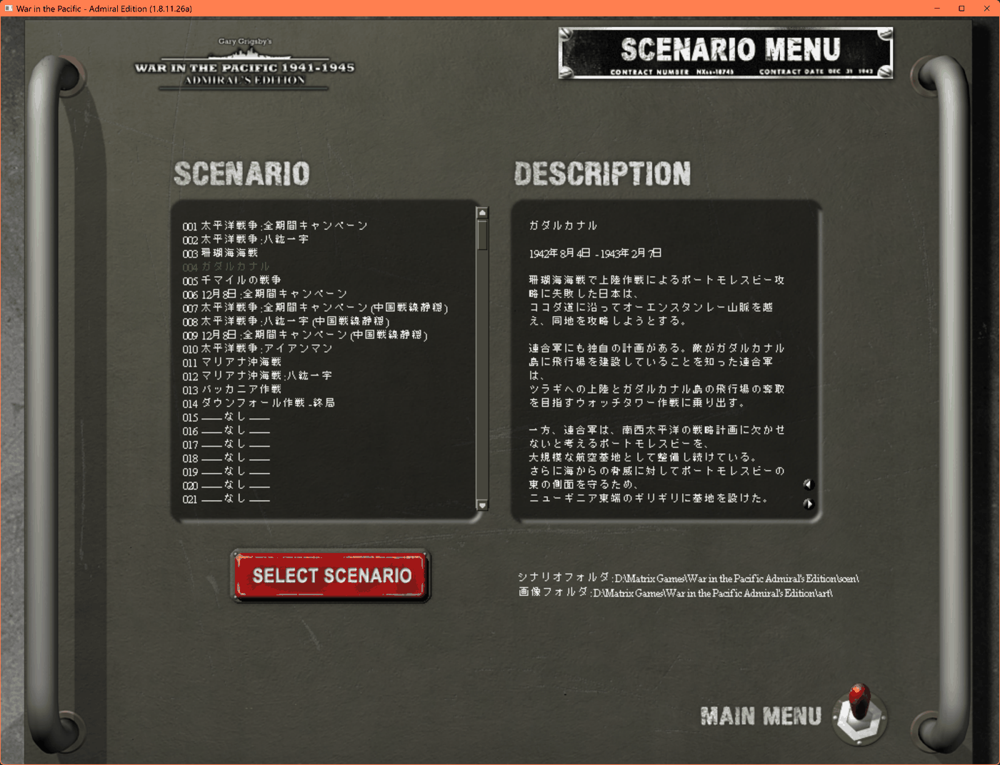
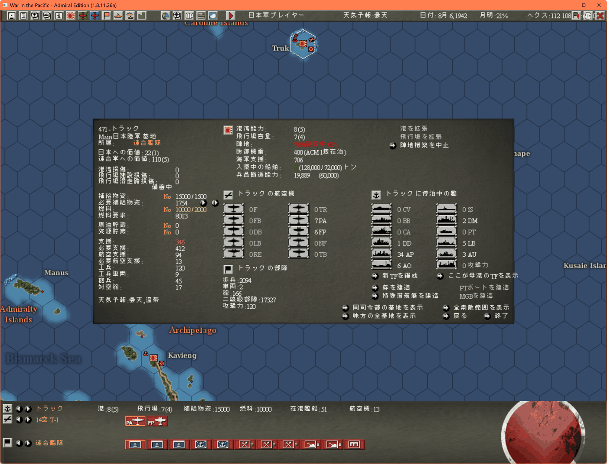
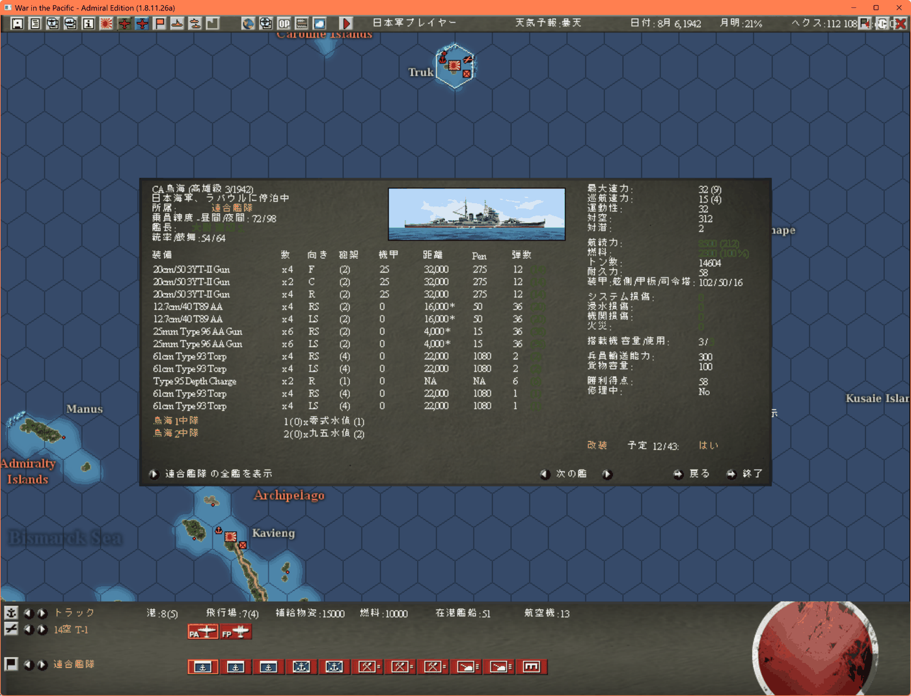
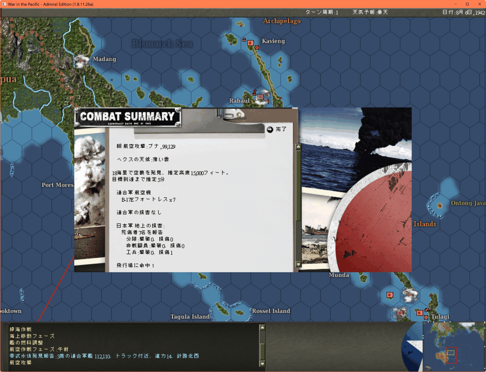
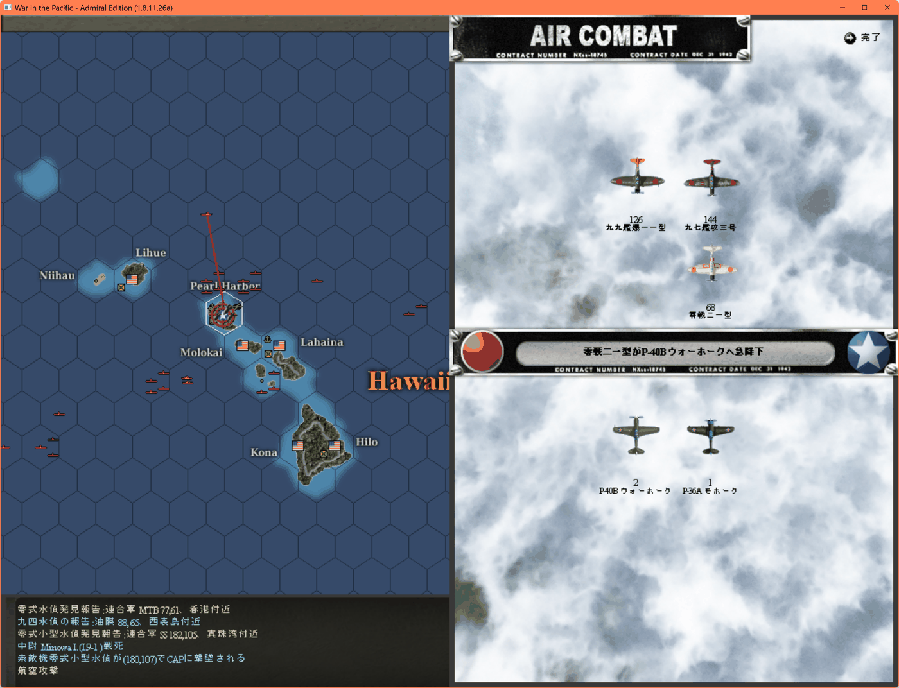

# War in the Pacific: Admiral's Edition — Japanese Localization (Unofficial)

An unofficial, fan-made Japanese localization for Matrix Games'
*[War in the Pacific: Admiral's Edition](https://www.matrixgames.com/game/war-in-the-pacific-admirals-edition)*.

- Translates UI text, combat reports, scenario descriptions, and names
  (ships, ship classes, aircraft, places, air groups, ground units,
  leaders and pilots). Japanese ships and aircraft use their Japanese names.
- The game's files are not modified. You just place files in the game
  folder, and removing them returns the game to English.
- A legitimately purchased copy of the game is required
  ([store page at Matrix Games](https://www.matrixgames.com/game/war-in-the-pacific-admirals-edition)). This repository
  and its downloads contain no original game program, data, or English
  text (translation keys are hash values of the English strings).

**Download: [Latest release](https://github.com/Yasabihhagure/war-in-the-pacific-ae-ja/releases/latest)**

## Screenshots

| Scenario selection | Base information |
| --- | --- |
|  |  |
| **Ship information** | **Combat report** |
|  |  |
| **Air combat** | |
|  | |

## Requirements

- Windows 10 / 11
- Game version: `War in the Pacific Admiral Edition.exe` dated
  2016-07-10, 5,054,464 bytes (in-game version notation 1.8.11.26a).
  Other versions will not work. To check your exe:
  - the title bar shows `(1.8.11.26a)`, or
  - the file size in Properties is 5,054,464 bytes, or
  - its SHA-256 is
    `772503d3c8be3a477227f423e7f7a33b7d091a6f9874d9258ab366cf5d1e0091`
    (PowerShell: `Get-FileHash "War in the Pacific Admiral Edition.exe"`).
  If the version does not match, `witpae_ja_log.txt` will show
  `bytes mismatch, skipped` and the game stays in English.

## Install

1. Download `witpae-ja-<version>.zip` from the latest release.
2. Verify the zip's SHA-256 against the value in the release notes
   (PowerShell: `Get-FileHash witpae-ja-<version>.zip`).
   The proxy DLL may be falsely flagged by security software;
   please check the hash before deciding to allow it.
3. Extract the zip into the game folder (where the exe is).
   This places `ddraw.dll`, `witpae_ja.ini`, and the `witpae_ja\`
   folder (translations).
4. Launch the game as usual. Windowed mode is recommended (see below).

### Recommended: windowed mode

Returning from Alt+Tab in fullscreen can corrupt the display (an issue
of the original game). Launching in windowed mode avoids it.

- `-w` starts the game in windowed mode; `-skipVideo` skips the intro
  video (it shows black when the window is enlarged).
- In windowed mode, the DLL enlarges the window to fit your screen
  (`[Display]` in `witpae_ja.ini`).

To create the shortcut:

1. In Explorer, right-click `War in the Pacific Admiral Edition.exe`
   and choose "Create shortcut".
2. Rename it to something like `WITPAE Windowed`.
3. Open the shortcut's Properties and append a space and
   `-w -skipVideo` to the end of "Target" (after the closing quote of
   `"...\War in the Pacific Admiral Edition.exe"`), then click OK.

Or run this in PowerShell from the game folder to create
`WITPAE Windowed.lnk`:

```powershell
$g = (Get-Location).Path
$s = (New-Object -ComObject WScript.Shell).CreateShortcut("$g\WITPAE Windowed.lnk")
$s.TargetPath = "$g\War in the Pacific Admiral Edition.exe"
$s.Arguments = "-w -skipVideo"
$s.WorkingDirectory = $g
$s.Save()
```

## Uninstall

Delete `ddraw.dll`, `witpae_ja.ini`, `witpae_ja_log.txt`, and the
`witpae_ja\` folder from the game folder (and the windowed-mode
shortcut, if you created one).

## Known issues / what stays in English

- Weapon names (e.g. `100 kg GP Bomb`) stay in English.
- Names too long for the 19-byte name field (e.g. `F4F-4 Wildcat`)
  stay in English.
- Text baked into images (main menu buttons, `COMBAT SUMMARY`, etc.)
  stays in English.
- Place names printed on the map itself are intentionally not
  translated, to keep the map's appearance; place names in base
  information and reports are in Japanese.
- Personal names are shown as translated surname + initials
  (e.g. Nagumo C.). Most Japanese surname kanji are best-effort
  guesses from the romanized spelling (692 entries marked as guesses
  in the surname table).
- A few translations are still unverified: 13 UI strings and 2 name
  entries are marked "to be confirmed" (mostly unclear usage or
  abbreviations). These will be checked in future versions.
- Where a ship and a place share the same spelling (e.g. Sendai), the
  ship translation is used only when the game displays it from ship data.
- Translations may overflow the original UI frames in places.

## How it works

The proxy `ddraw.dll` forwards calls to the real `ddraw.dll` while
replacing some of the game's functions in memory (the exe file itself
is never modified). Japanese text is rendered via GDI with a Japanese
font, format strings and names are substituted from hash-keyed
translation tables, and scenario description files are swapped when
opened. Technical details: [docs/TECHNICAL.md](docs/TECHNICAL.md)
(in Japanese).

## License

- Source code and tools (`src/`, `tools/`): MIT License.
- Translations (`translation/` and the contents of `witpae_ja\` in the
  download) are derivative works of the original game's text. All
  rights in the original work remain with Matrix Games / 2 by 3 Games.
  Please keep any reuse of the translations within the scope of
  playing the game you own.
- This is an unofficial fan project, not affiliated with the rights
  holders. If the rights holders make a request, including removal,
  I will comply.

Bug reports and translation corrections are welcome via
[Issues](https://github.com/Yasabihhagure/war-in-the-pacific-ae-ja/issues).
