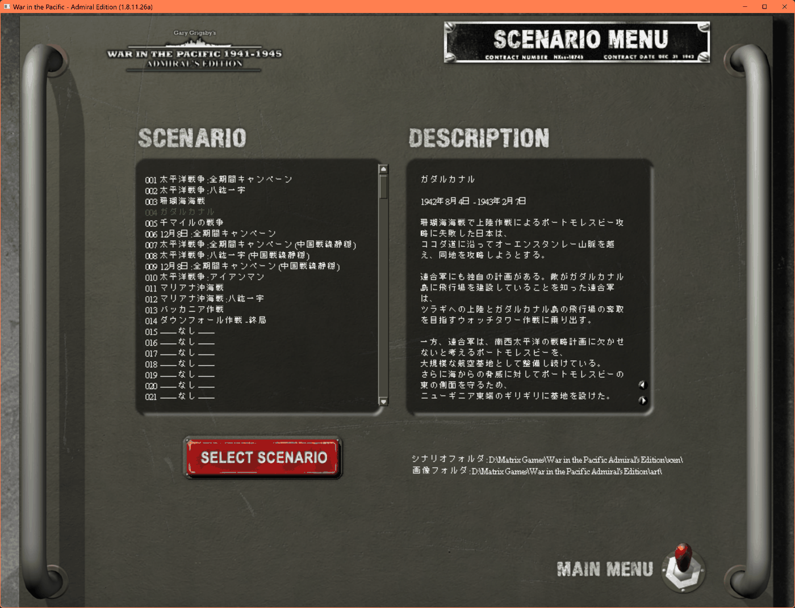
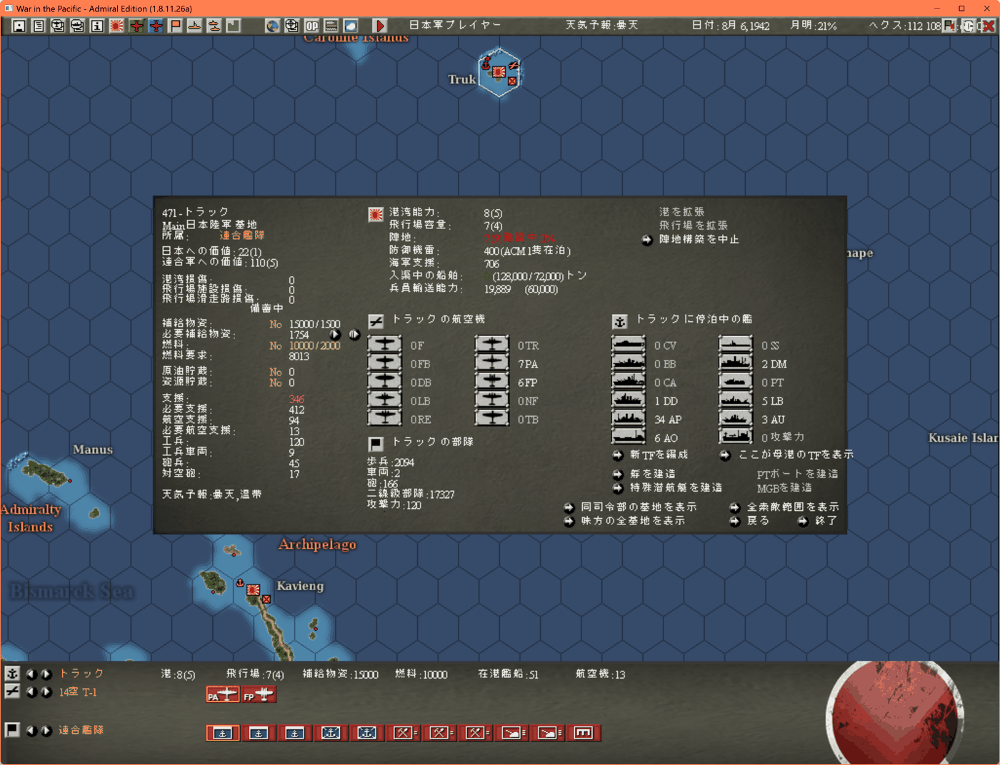
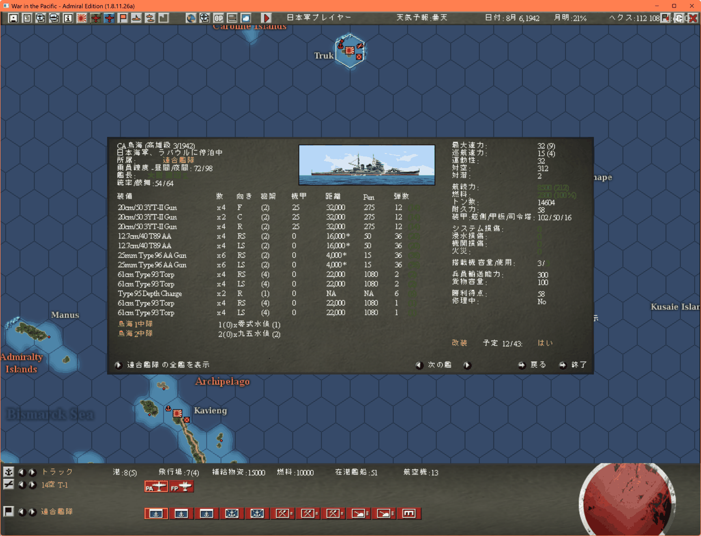
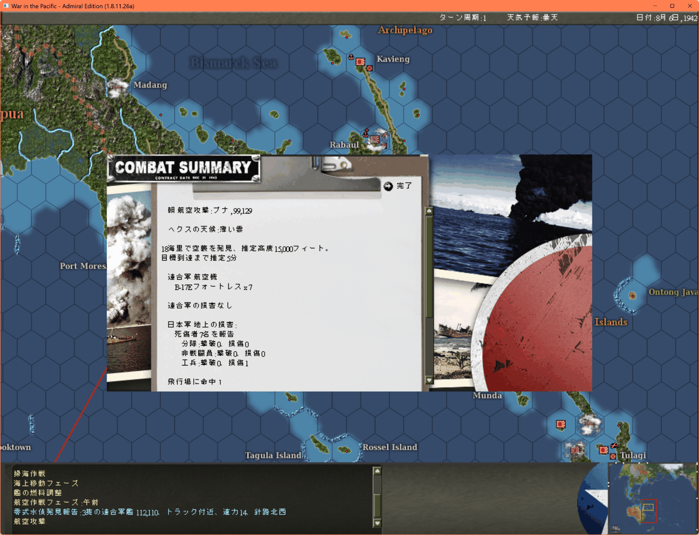
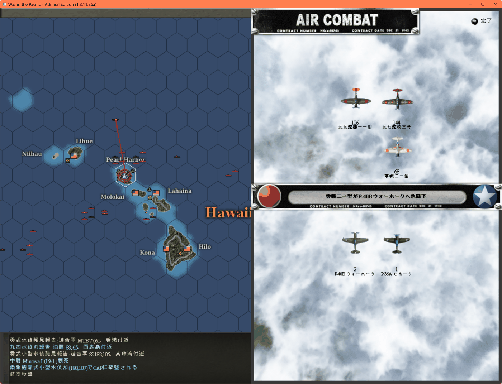

# War in the Pacific: Admiral's Edition 日本語化（非公式）

Matrix Games の『War in the Pacific: Admiral's Edition』を日本語で遊ぶための、非公式のファンメイド日本語化です。

**ダウンロード: [最新版（Releases）](https://github.com/Yasabihhagure/war-in-the-pacific-ae-ja/releases/latest)**（`witpae-ja-版.zip`）

- 画面の文言、戦闘報告、シナリオの説明文、艦船・艦型・航空機・地名・部隊・人物の名前を日本語にします。日本の艦艇・航空機は日本側の名称です（例: Zeke → 零戦二一型）。
- ゲームの元ファイルは書き換えません。ゲームのフォルダにファイルを置くだけで日本語になり、外せば英語に戻ります。
- 遊ぶには、正規に入手したゲーム本体が必要です。このリポジトリと配布物には、原作のプログラム・データ・英文は含まれません。

## 画面

| シナリオの選択 | 基地の情報 |
| --- | --- |
|  |  |
| **艦の情報** | **戦闘報告** |
|  |  |
| **空戦** | |
|  | |

## 対応する環境

- Windows 10 / 11
- ゲーム本体: `War in the Pacific Admiral Edition.exe`（ゲーム内の表記 1.8.11.26a、2016-07-10、5,054,464 バイト）

自分の exe が対応する版か確かめるには、次のどれかを見てください。

- ゲームのウィンドウの題名（タイトルバー）に `(1.8.11.26a)` と出る。
- exe のプロパティで、サイズが 5,054,464 バイト。
- SHA-256 が `772503d3c8be3a477227f423e7f7a33b7d091a6f9874d9258ab366cf5d1e0091`（PowerShell で `Get-FileHash "War in the Pacific Admiral Edition.exe"`）。

ほかの版では動きません。版が違うと、ゲームのフォルダの `witpae_ja_log.txt` に `bytes mismatch, skipped` と出て、日本語が表示されません。

## 導入

1. [Releases](https://github.com/Yasabihhagure/war-in-the-pacific-ae-ja/releases/latest) から `witpae-ja-版.zip` をダウンロードする。
2. 念のため、zip の SHA-256 がリリースの説明に書いた値と同じか確かめる（PowerShell で `Get-FileHash witpae-ja-版.zip`）。
3. zip を、ゲームのフォルダ（`War in the Pacific Admiral Edition.exe` があるフォルダ）に展開する。次のものが置かれます。
   - `ddraw.dll`（差し替え DLL）
   - `witpae_ja.ini`（設定）
   - `witpae_ja\`（訳文）
4. いつもどおりゲームを起動する。

`ddraw.dll` は、ゲームの動作を差し替える DLL なので、セキュリティソフトに誤って検出されることがあります。検出されたときは、上の SHA-256 で配布物が本物であることを確かめてから、許可するか判断してください。

### おすすめの起動方法

フルスクリーンで Alt+Tab から戻ると、画面が乱れることがあります（このゲームにもともとある問題です）。ウィンドウモードで起動するのがおすすめです。

- ゲームの exe のショートカットを作り、リンク先の末尾に ` -w -skipVideo` を付ける。
- `-w` はウィンドウモード、`-skipVideo` は起動時の動画を飛ばす（ウィンドウを拡大していると動画が黒く映るため）。
- ウィンドウモードでは、DLL がウィンドウを画面に収まる大きさまで拡大します（`witpae_ja.ini` の `[Display]`）。

## 取り外し

ゲームのフォルダから、次のものを削除すると英語版に戻ります。

- `ddraw.dll`
- `witpae_ja.ini`
- `witpae_ja_log.txt`
- `witpae_ja\` フォルダ

## 設定（`witpae_ja.ini`）

ふだん変えるもの:

| 項目 | 既定 | 内容 |
| --- | --- | --- |
| `[Display] Scale` | auto | ウィンドウモードの拡大率。`auto`（画面に収まる最大）、`0`（拡大しない）、`1.5` などの数値 |
| `[Display] Borderless` | 0 | 1 で枠なしの全画面ウィンドウ |
| `[Display] Smooth` | 1 | 1 でなめらかに拡大（0 は粗いが軽い） |
| `[Display] DpiAware` | 1 | 1 で Windows の表示スケールによる拡大を止める（画面が切れる対策） |
| `[JpFont] HeightAdjust` | -2 | 日本語の文字の高さの補正（ピクセル。負で小さく） |
| `[JpFont] YOffset` | 0 | 日本語の文字の上下位置の補正（ピクセル。正で下へ） |
| `[Font] Face` | MS Gothic | 日本語の描画に使うフォント |
| `[Text] Translate` | 1 | 0 で訳文に置き換えない（英語のまま） |
| `[Text] ScenWidth` | 270 | シナリオ説明の1行の幅（ピクセル。ゲームの枠は 280） |

問題の切り分けや、訳の作業に使うもの:

| 項目 | 既定 | 内容 |
| --- | --- | --- |
| `[Text] GameHooks` | 1 | 0 でゲーム内部の関数を差し替えない（日本語は表示されない） |
| `[Text] TranslateArgs` | 1 | 0 で文の中に入る名前などを訳さない |
| `[Text] ReplaceScenText` | 1 | 0 でシナリオ説明を差し替えない |
| `[Display] GameWidth`、`GameHeight` | 1024、768 | 起動直後に想定するゲームの解像度（ふつうは変えない） |
| `[Font] Replace`、`Charset`、`HeightAdjust` | 0、128、0 | ゲームの英字フォントの差し替え（試作の名残。ふつうは 0 のまま） |
| `[Debug] LogText` | 0 | 1 で、描かれた文字列を `witpae_ja_log.txt` に記録する（訳の作業用。ファイルが大きくなる） |
| `[Debug] LogNameAddr` | 0 | 1 で、名前の文字列のメモリ上の場所を記録する（解析用） |

既定は、ini に項目がないときの値で、配布する ini の値と同じです。

## 既知の問題と、英語のまま残るもの

- 兵器の名前（`100 kg GP Bomb`、`Type 95 Tankette` など）は英語のままです。
- 名前の欄（19 バイト）に収まらない長い名前（`F4F-4 Wildcat` など）は英語のままです。
- 画像の中の文字（ボタン、`COMBAT SUMMARY` などの見出し）は英語のままです。
- マップ上の地名（Truk、Rabaul など）は、美観を損ねるため日本語化していません。基地の情報や報告の中の地名は日本語です。
- 人物の名前は「姓の訳 + 頭文字」（例: 南雲 C.、ハルゼー W.F.）です。日本人の姓の漢字の多くはローマ字からの推測です（姓の表の 692 件に「推測」の印）。
- 訳に自信がなく「要確認」の印を付けたものが、画面の文言に 163 件あります。名前の表には「要確認」と「不確か」の印が合わせて 54 件あります。次の版以降で点検します。
- 艦と地名で同じ綴りの名前（Sendai など）は、ゲームが艦のデータから表示する場合だけ艦の訳（川内）になります。
- 枠の幅は英語に合わせてあるため、訳文がはみ出す場所があるかもしれません。

不具合や訳の誤りは [Issues](https://github.com/Yasabihhagure/war-in-the-pacific-ae-ja/issues) で知らせてください。

## 仕組み

差し替えの `ddraw.dll` は、本物の `ddraw.dll` に処理を引き継ぎながら、ゲームの中の関数をメモリ上で差し替えます（exe のファイルは書き換えません）。

- 文字の描画と幅の計算: ゲームは英数字だけの自前の文字画像で文字を描くので、日本語の部分は GDI（日本語フォント）で描きます。折り返しも日本語に合わせます。
- 文の組み立て（sprintf など）: 書式の文を訳文に、`%s` に入る文字列（名前など）を対訳表の訳に差し替えます。
- シナリオの説明文: `SCEN\*.txt` を開くときに、訳文のファイルに差し替えます。
- ウィンドウモードの拡大: 画面の写しを持ち、自前で拡大して描きます。

解析のメモとアドレスは [docs/TECHNICAL.md](docs/TECHNICAL.md) にあります。

## 訳を直す・翻訳に参加する

訳文ファイルには原作の英語を入れていません（キーは英文のハッシュ値です）。手元のゲームから英語と訳を並べた表を作って直し、訳だけを書き戻します。手順は [translation/HOWTO.md](translation/HOWTO.md)、表記の決まりは [translation/STYLE.md](translation/STYLE.md)、用語は [translation/glossary.tsv](translation/glossary.tsv)、日本機の名称の対応は [translation/aircraft_codes.md](translation/aircraft_codes.md)。

| パス | 中身 |
| --- | --- |
| `translation/ja.tsv` | 画面の文言の訳 |
| `translation/names/` | 名前の訳（艦船、艦型、航空機、地名、航空隊、地上部隊、指揮官、パイロット） |
| `translation/surnames.tsv` | 人物の姓の訳（人物の名前を組み立てる資料。ゲームには置かない） |
| `translation/scen/` | シナリオの説明文の訳 |
| `translation/unit_types.tsv` | 地上部隊の種類（名前のつなぎ方に使う） |
| `src/ddraw/` | 差し替え DLL のソース（C++） |
| `tools/` | 作業用の表の作成・取り込み、配置、配布物の作成 |
| `docs/` | 技術資料と画面の画像 |

## ビルドと配布物の作成

[llvm-mingw](https://github.com/mstorsjo/llvm-mingw) の i686 向けコンパイラ、Python 3、Git Bash（`sh`）を使います。場所は環境変数で変えられます。

| 環境変数 | 既定 | 使うもの |
| --- | --- | --- |
| `LLVM_MINGW` | `D:/Tools/llvm-mingw` | `src/ddraw/build.sh` |
| `WITPAE_GAME` | `D:\Matrix Games\War in the Pacific Admiral's Edition` | `tools/*.py`、`tools/deploy.sh`、`tools/uninstall.sh` |

```sh
export LLVM_MINGW="C:/llvm-mingw"                                   # 例
export WITPAE_GAME="C:\Games\War in the Pacific Admiral's Edition"  # 例
sh src/ddraw/build.sh          # src/ddraw/build/ddraw.dll を作る
sh tools/deploy.sh             # ゲームのフォルダに配置する（開発用）
python tools/package.py 0.1.0  # dist/witpae-ja-0.1.0.zip を作る
```

注意: llvm-mingw の一部のファイル（`clang-23.exe`、`ld.lld.exe` など）や、ビルドした `ddraw.dll` が、セキュリティソフトに誤って検出され、隔離・削除されることがあります（ESET で `clang-23.exe` と `ld.lld.exe` が削除された例があります）。「`clang-23` が見つからない」などのエラーでビルドが止まったら、セキュリティソフトの検出履歴を確かめ、消えたファイルを配布元の zip から戻してください。検査の除外に加える場合は、公式の GitHub のリリースから取ったものに限ってください。

## ライセンス

- **ソースコードと道具**（`src/`、`tools/` など）は [MIT ライセンス](LICENSE) です。
- **訳文**（`translation/` の訳、配布物の `witpae_ja\` の中身）は、原作のテキストの二次的な著作物です。原作の権利は、その権利者（Matrix Games / 2 by 3 Games）に残ります。訳文の再利用は、この日本語化と同じく、原作を正規に持つ人がゲームで遊ぶための範囲にとどめてください。
- この日本語化は非公式のもので、権利者とは関係ありません。権利者から求めがあれば、公開の取りやめなど、求めに応じます。

## 謝辞

考え方は [Ultima 日本語化](https://higesho.github.io/ultima-ja/) を参考にしました。
